# ▟▙ forge

**An agent team that designs 3D-printed mechanisms and proves they'll print before you print them.**

forge is a design-for-print pipeline tuned for a **Bambu Lab X1C** and **PETG**. Parts are parametric
[build123d](https://github.com/gumyr/build123d) code. Every claim about a part (it prints without supports, it clears its neighbour, the snap stays under its strain limit, it takes 38 g and 1 h 36 m) comes from a tool that writes a **hash-stamped result**. Agents design, review and simulate. A human signs off on the exact build that gets printed.

<p align="center">
  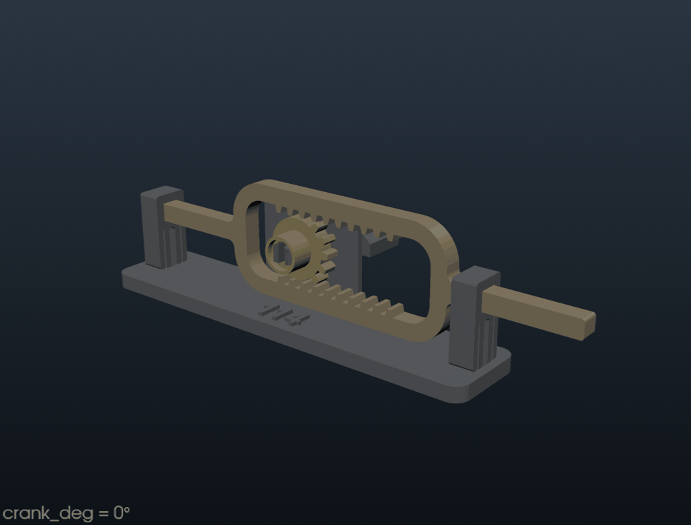
  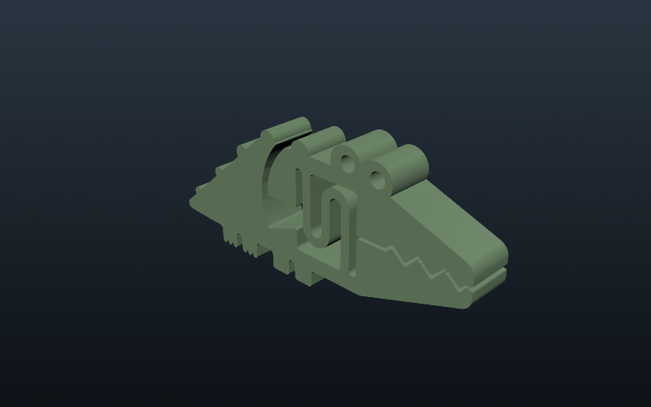
</p>

<p align="center">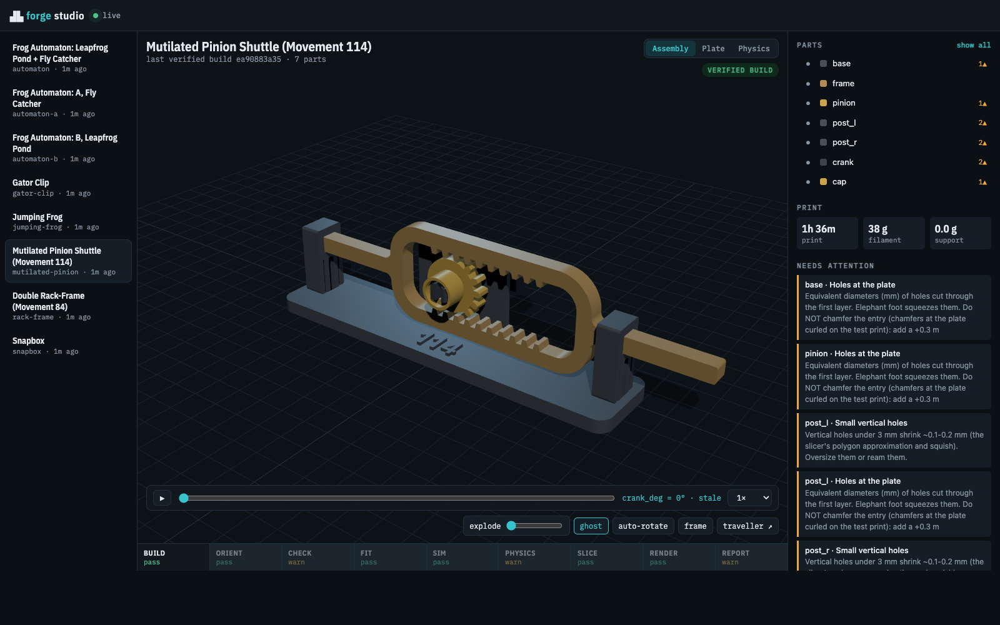</p>

---

## What it's made so far

| | | |
|:-:|:-:|:-:|
|  |  | 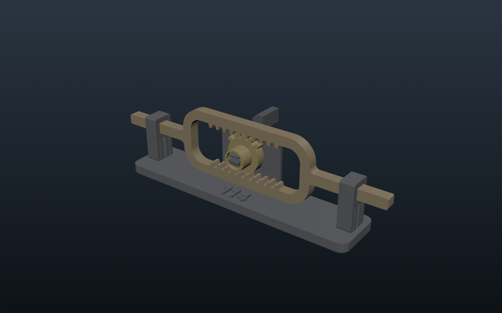 |
| **Jumping frog**: one part, a printed leaf spring flicks it. 17 min · 7.1 g · peak strain 67% of allowable. *Released.* | **Gator clip**: one-piece compliant clip; an S-meander spring holds the jaws shut. 21 min · 9.7 g · 77% strain. *Released, test print "worked excellently".* | **Movement 114**, mutilated pinion (Brown, *507 Mechanical Movements*, 1868): a 5-of-15-tooth gear shuttles a double-racked frame. 7 parts · 1 h 36 m · 38 g. *Released.* |
| 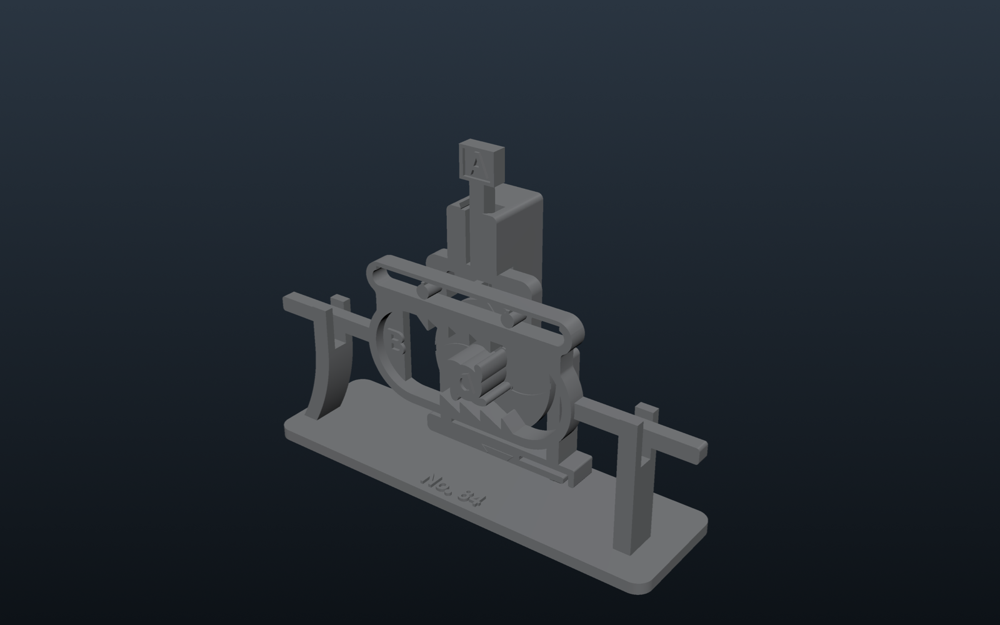 | 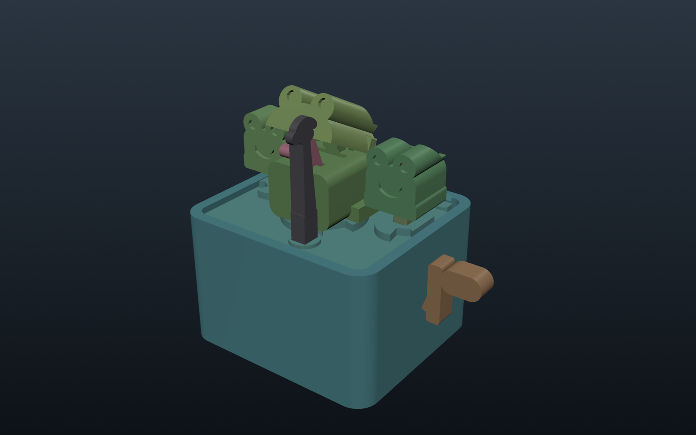 | 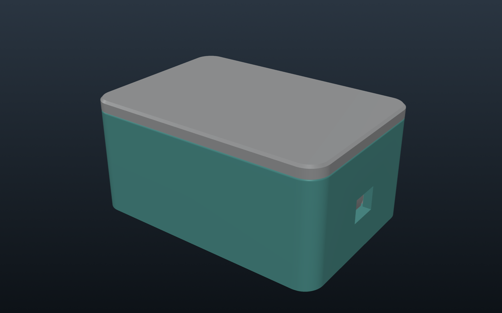 |
| **Movement 84**, double rack-frame: a bladed cam plus a selector gives forward, reverse or neutral. 6 parts · 1 h 29 m. *In review.* | **Frog automaton**, leapfrog pond + fly catcher: a crank-driven cam stack, 14 snap-together parts. 2 h 05 m · 66 g. *In detail design.* | **Snapbox**: the first example and calibration piece. 2 parts · 48 min · 32 g. |

Every part prints with **zero supports**. Nothing is glued or screwed: retention is by snaps (checked by FEA), captured parts or press fits.

---

## How it works

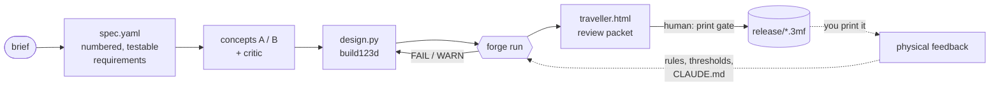

`forge run` is the verification chain. Each stage writes a JSON result bound to the **build hash**. The hash covers the spec, the design, the material and fit data, the calibration and the verification code itself, so a result from a previous build is never quoted as current.

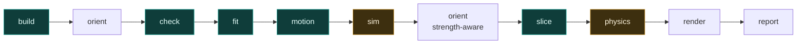

| Stage | Tool | What it proves | Evidence |
|---|---|---|---|
| **build** | build123d / OpenCascade | valid closed solids; STEP + STL | verified |
| **orient** | trimesh + FEA stress field | best print pose by support area, height, bed contact, show faces and **strength across layers** | verified / estimated |
| **check** | trimesh, shapely, B-rep features | manifold, bed fit, supports, anchored bridges, walls, islands, adhesion, plus the FDM footguns below | verified / measured / heuristic |
| **fit** | OpenCascade B-rep | no collisions; every declared fit has its clearance at the tightest point; retention is declared | verified |
| **motion** | parametric pose sweep | the mechanism moves through its range with no collisions, measured travel, and drive pairs that really engage | verified |
| **sim** | gmsh tet10 → CalculiX C3D10 | static safety factor (XY vs Z strength), **large-deflection flexures and snap fits** (force-deflection, strain vs allowance), mesh convergence | estimated |
| **slice** | Bambu Studio CLI | it really slices with *your* flattened presets (G-code header checked); time, grams, support grams, seams | verified |
| **physics** | MuJoCo | joints, driver and contacts inferred from the sweep; follower lift-off vs crank speed | estimated |
| **report** | — | one self-contained traveller: renders, evidence ledger, load cases, plates, journal | — |

**Evidence kinds are never mixed up.** *Verified* means a geometric or slicer fact. *Measured* means sampled geometry. *Heuristic* is a rule of thumb. *Estimated* covers FEA and material data. The traveller labels every number with its kind.

### The checks know FDM's footguns
Every check has a **known-bad fixture that must fail** (`tests/test_checks_fail.py`). Many come straight from failed test prints:

- **Rounds or chamfers where walls meet the plate.** Banned after 45° bed chamfers curled on a test print. Walls meet the plate vertically.
- **Horizontal round holes** (the crown droops), **pins printed upright** (they snap along layers), small vertical holes, and holes through the first layer.
- **Thin gaps under a ceiling** (`z_fuse`): the bridge sags and welds a snap finger to its skin.
- **Sharp vertical corners** on large footprints (they lift and warp), slender towers, and PETG stringing across scattered islands.
- **Rounded surfaces facing up** (stair-stepping) and anything that needs supports.

<p align="center">
  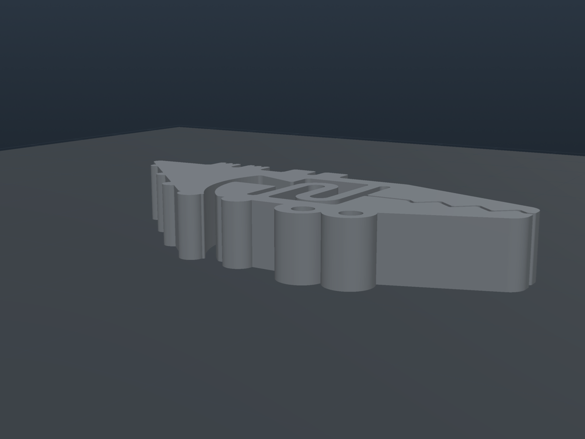
  
</p>

---

## Simulation you can trust (and know when not to)

<p align="center">
  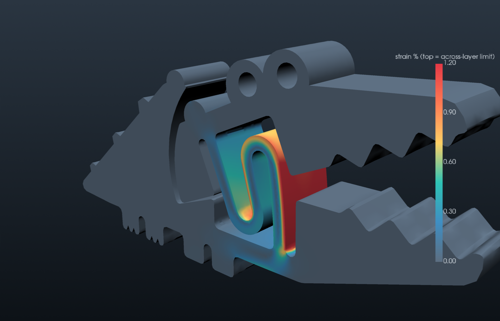
  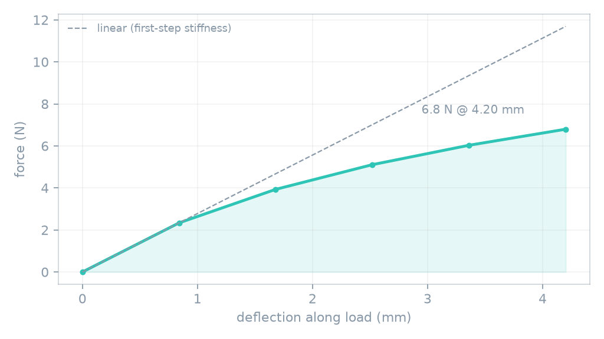
</p>

- **FEA:** gmsh quadratic tets and CalculiX with **NLGEOM**, for flexures and snap fits.
  - **Validation:** against Timoshenko beam theory: 1.3% off when measured, and the test fails above 4%. Displacement control agrees with force control on the same load within 8% (`tests/test_fea_validation.py`).
  - **Loading:** snap lips are loaded on a thin line through a distributing coupling. Loading the whole face locks the tip's rotation and overstates the strain about 2×.
  - **Reported numbers:** the headline excludes nodes that are fixed or under the load, and every case gets a **mesh-convergence pass**. A change over 10% is flagged.
  - **Anisotropy:** strength and strain limits differ in-layer vs across-layer (×0.6 across), with separate limits for one-time and repeated use.
- **Physics:** MuJoCo infers joints and contacts from the motion sweep and is validated against e·ω² = g. It refuses to claim a result outside its validated envelope (gravity-returned followers, driver not stalled).
- **Ground truth beats simulation.** A 0.4 mm snap lip that simulated fine gave *no felt click*. The rule is now ≥ 1 mm engagement and 5–15 N.

<p align="center">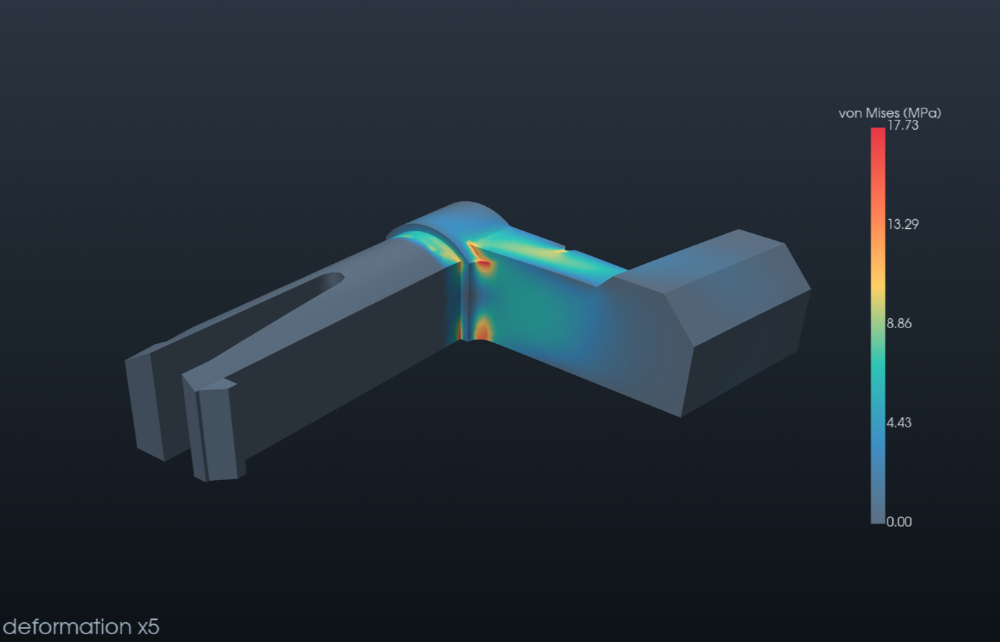</p>

### Sketch first: mechanisms solved in 2D before CAD
The double rack-frame went round twice in 3D before its drive was solved by a quick **2D contact study**. It runs shapely profiles of the real blade, a push-only frame and three tolerance depths, and shows exactly one 6 mm tooth per blade at every depth. A pitch of 5 mm or less runs away. The mechanism is now worked out on paper before anyone writes `design.py`.

<p align="center">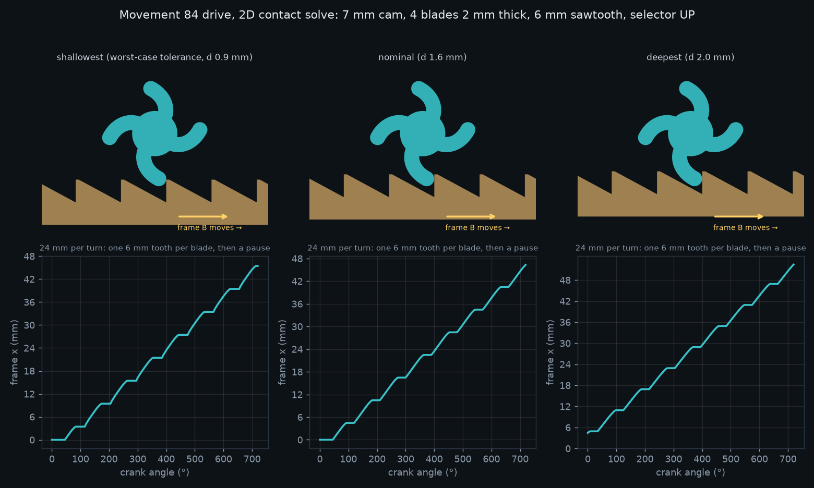</p>

---

## forge studio: watch the agents work

`forge studio` is a live dashboard. Every save of a `design.py` hot-reloads a geometry preview, and a badge always says whether you're looking at an **unverified live preview** or a **verified build**.

| Assembly, exploded | Print plate (read back from the sliced 3MF) |
|:-:|:-:|
|  |  |

**Live physics.** MuJoCo runs in real time in the dashboard. Drag the crank dial, set a motor speed, or grab any moving part and poke it. Chips show whether each follower is riding its cam or airborne.

<p align="center"></p>

Other features:
- **Parts:** click to isolate one, ghost the rest, explode the assembly, and see each part's warnings.
- **Motion sweeps:** play them back, scrub through them, or deep-link (`?mode=plate|physics&explode=0-100#project`).

---

## Human oversight

- **One mandatory gate: print.**
  - `forge approve <p> print` runs only in an interactive terminal and asks you to type the project name. It's a guard rail an agent's shell can't pass by accident. Optional deny rules are in `docs/claude-settings.proposed.json`.
  - The approval binds to the build hash, so any later edit invalidates it.
  - Spec and concept choices are made in conversation and logged.
- **Journal.** Every decision, failure, root cause and human comment is timestamped in `projects/<p>/journal.md`, with human comments in their own words.
- **Traveller.** `build/traveller.html` is the review packet. Agents publish it so you can comment on it.
- **Release.** `forge release` copies the approved 3MFs to `release/`. **forge never talks to the printer.**

### Faithful to the source
Historical movements are checked against the engraving, not just against the spec.

<p align="center">
  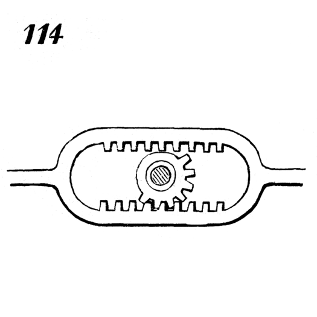
  
</p>

---

## The team

Agents live in `.claude/agents/`, and the workflow is the `/forge` skill (`.claude/skills/forge/SKILL.md`).

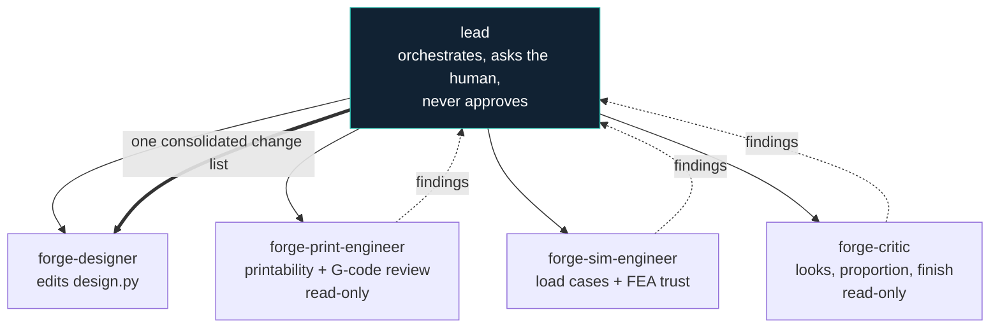

Start a design in Claude Code with:

```text
/forge my-thing a wall bracket for a 30 mm pipe
```

---

## Quick start

```bash
make setup                          # python3.12 venv, deps, CalculiX
.venv/bin/forge doctor              # toolchain + flattened X1C presets
.venv/bin/forge run snapbox         # the example, end to end
.venv/bin/forge open snapbox        # the traveller
.venv/bin/forge studio              # live dashboard → http://127.0.0.1:8765
make test                           # FEA validation + known-bad fixtures
```

**Requirements:**
- macOS with Bambu Studio installed (its CLI does the slicing).
- Python 3.12.
- FreeCAD.app: `make tools` copies its CalculiX `ccx` and fixes the libgfortran rpath.

<details>
<summary><b>All commands</b></summary>

```text
forge doctor | list | new <p> | build | orient | check | fit | sim [--case] [--fast]
forge slice | physics [--rpm N] [--scan] | render | report | run [--fast] | status | open
forge preview | studio | note <p> "text" [--kind] [--author]
forge flex cantilever|hinge ...      # closed-form flexure sizing
forge coupon | calibrate ...         # clearance calibration print
forge approve <p> print              # humans only, interactive
forge release <p>
```
</details>

<details>
<summary><b>Hard-won facts</b> (things that cost a debugging session each)</summary>

- **Bambu Studio CLI:**
  - It does **not** resolve preset `inherits`: a raw system preset slices with a 200×200×100 bed, PLA and 0 g. forge flattens the presets, sets `from: system`, and checks the G-code header.
  - Seam position is relative to the **plate**, and arrange may rotate the part. On the gator clip, `back` put 43 seams in the mouth. Always verify seams in the G-code.
- **FEA:**
  - gmsh tet10 to CalculiX C3D10 needs the last two edge nodes swapped.
  - Use `*NODE FILE, FREQUENCY=100000`: writing every NLGEOM increment made 430 MB `.frd` files.
- **MuJoCo:** needs dt 0.1 ms with a 2 ms contact; coarser steps chatter and fake early jumps. Don't cap hull vertices: faceted cams kick followers.

See [`CLAUDE.md`](CLAUDE.md) for the full list.
</details>

## Calibrate your printer
Fit clearances ship as uncalibrated defaults. Generate the coupon with `forge coupon`, run it through `forge run _coupon`, and print it. Then record what worked with `forge calibrate --press .. --snug .. --sliding .. --loose ..`.

## Honest limits

- **Material data:** PETG data is low-confidence (sources disagree by about 2× on modulus), so forge uses the conservative values.
- **FEA assumptions:** stiffness is treated as isotropic, parts as solid (no infill), and creep, fatigue and contact are ignored.
- **Physics coverage:** MuJoCo isn't valid for gear and rack trains, and says so.
- **Human judgement:** fit *feel* and aesthetics stay with you. That's what the print gate and the test prints are for.
