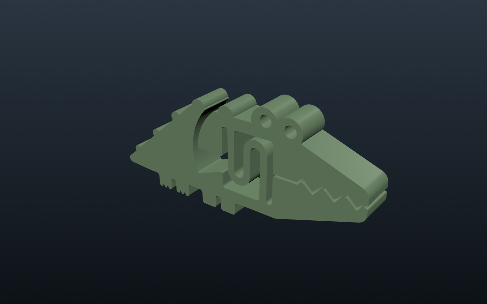
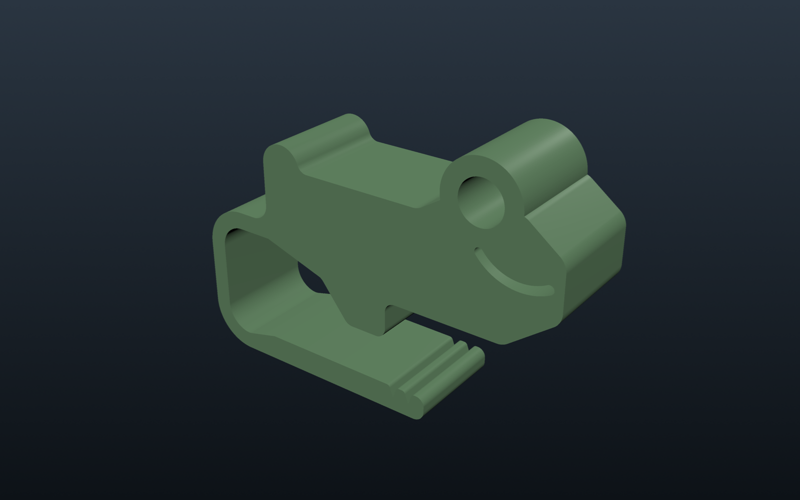
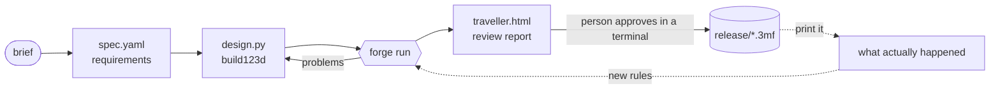
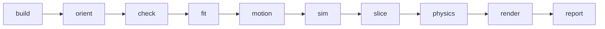
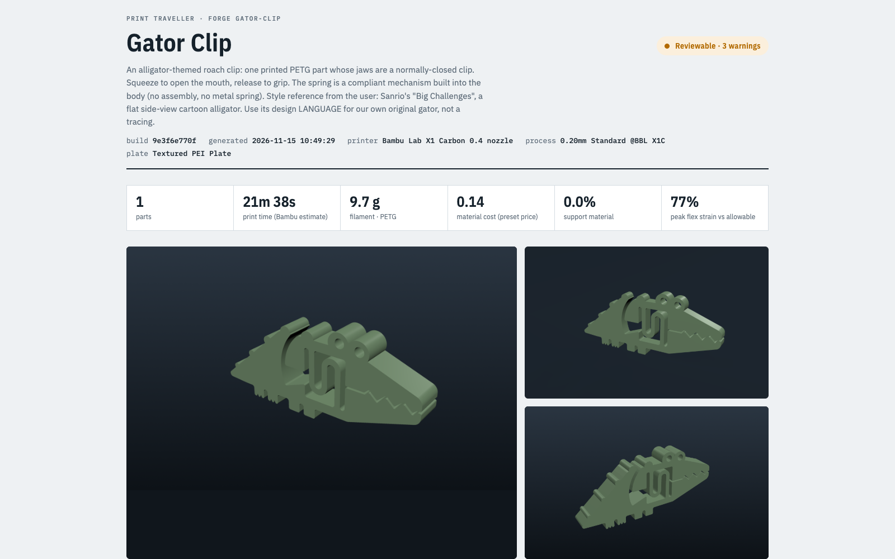
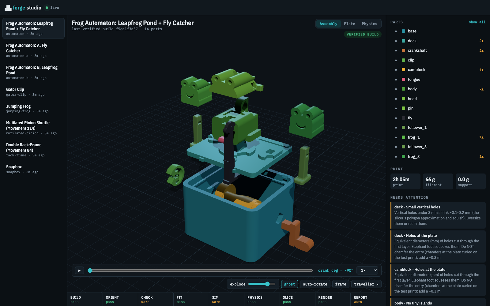
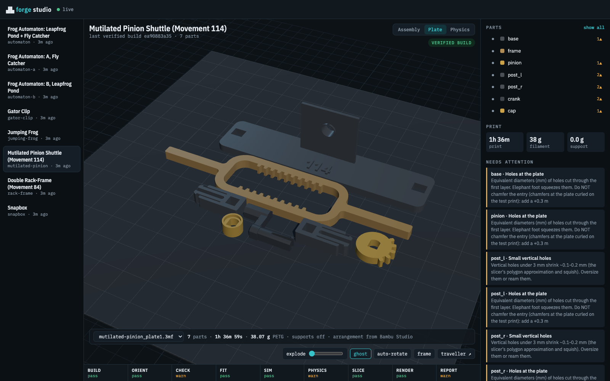
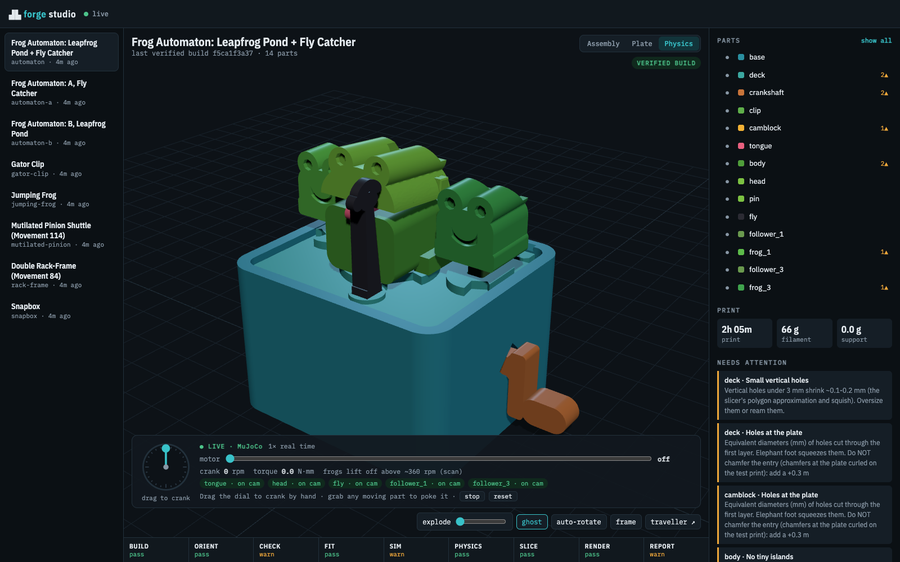

# forge

An experiment in getting Claude agents to design 3D-printable mechanisms, and in checking those designs with real tools before anything is printed. It's built around one printer (a Bambu Lab X1C, 0.4 mm nozzle) and one material (PETG). It runs on macOS.

This is a working notebook, not a product. Most of it was built over a couple of days of agent sessions, and only a few designs have been printed so far. Below, things are marked by how we know them:
- **tested on a print:** someone held the part.
- **checked by a tool:** a slicer, CAD kernel or solver says so.
- **untested:** we think it's right but haven't confirmed it.

<p align="center">
  
  
</p>

## The idea

Designs are parametric [build123d](https://github.com/gumyr/build123d) Python. Agents write and revise them. A command-line tool (`forge`) runs a fixed set of checks on every build:
- printability rules;
- collisions and clearances;
- a motion sweep;
- FEA on the parts that bend;
- slicing with the real Bambu Studio CLI;
- a rigid-body physics sim.

Each result is stored against a hash of the design, the spec, the data files and the checking code, so a number from an old build can't be quoted as current. A person reviews a generated report and approves printing in a terminal. forge never talks to the printer.

What we wanted to find out: can agents produce parts that print well first time, and can the checks catch the problems before plastic does? So far the answer is *partly* (see below).

## What's been printed, and what happened

| Design | Printed? | What we learned |
|---|---|---|
| <br>**Snapbox** (first test) | Yes, an early build | The parts were strong. The 45° chamfers where walls met the bed **curled**. The 0.4 mm snap lip gave **no felt click**; it was indistinguishable from layer lines. Both became rules: walls meet the bed vertically, and snaps need ≥ 1 mm engagement. |
| <br>**Gator clip** (one-piece compliant clip) | Yes, an earlier revision | "Worked excellently." The 0.9 mm toe notches printed fine; a review agent had predicted they'd be fuzz. The released build has since been polished and **hasn't been printed**. |
| <br>**Movement 114**, mutilated pinion (Brown, 1868) | Yes | The snap-together assembly was easy and sturdy, and the sliding frame "works very very well". But the crank axle had **a lot of slack**: the gears didn't mesh well, rotation wasn't clean, and the crank worked the front hub loose. See [What 114 taught us](#what-114-taught-us). A v2 is in progress. |
| <br>**Jumping frog** | Released, no feedback yet | Untested. |
| <br>**Movement 84**, double rack-frame | No | Took three attempts. The first two were rejected because the mechanism didn't make sense. A quick 2D contact study solved it. In review now. |
| <br>**Frog automaton** (crank-driven cams, 14 parts) | No | Still in detail design. The crank shaft's strength target took most of a day to chase. |

So far no design has gone from agent to finished print with no surprises. The checks did catch many things before printing, including supports, fused gaps, seams on snap roots, collisions and weak snaps. But all three physical problems we've seen (curling chamfers, a snap that didn't click, axle slack) were found by printing, not by the checks. Each one became a new rule or check. That's the main lesson so far.

## What the checks do, and how far to trust them

| Check | How | What it's been tested against | Trust it for |
|---|---|---|---|
| **Slicing** | Bambu Studio CLI with flattened presets; the G-code header is checked against what was asked for | Real slicer output. Times and grams are Bambu's estimates. | Print time, filament, support, whether it slices at all, where seams land |
| **Printability** | Geometry rules on the mesh and B-rep: overhangs, bridges, thin walls, islands, horizontal holes, upright pins, thin gaps that fuse, and more | Every rule has a known-bad fixture that must fail (`tests/test_checks_fail.py`). Thresholds come from rules of thumb and two test prints. | Catching known FDM mistakes. It knows nothing it hasn't been told. |
| **Fits and collisions** | Exact B-rep distances, at nominal geometry, over a motion sweep | Geometry only | Parts not colliding at nominal size. **It doesn't model print tolerance or play.** Movement 114 passed with about 1 mm of possible axle play. Fit clearances are **uncalibrated** defaults. |
| **Motion sweep** | Rebuilds the design at each step of a parameter (e.g. crank angle) | — | Collisions along the motion the design *asserts*. It doesn't prove the contacts would produce that motion: rack-frame v2 passed 72 poses and was still wrong. |
| **FEA** | gmsh + CalculiX, nonlinear for snaps and flexures, with a mesh-convergence pass | Beam theory (1.3% off in the measured run; the test fails above 4%), and force control against displacement control. **Never compared with forces measured on a print.** PETG material data is low-confidence. | Comparing designs and spotting weak spots. Treat absolute forces and safety factors as estimates. The 5–15 N "felt click" target is a guess that hasn't been confirmed yet. |
| **Physics** | MuJoCo, with joints and contacts inferred from the motion sweep | One validation: cam-follower lift-off against e·ω² = g | Intuition about cam followers. Gear and rack teeth jam in it, so those drives fall back to following the sweep (labelled in the UI). Not a verdict on anything. |
| **Strength-aware orientation** | Scores print orientations using the FEA stress field | Disagreed with the FEA safety factor on movement 114, not yet investigated | A suggestion only |

## Things we think will help but haven't tested

- **Axle rules from the 114 print.** Measured in the design's own geometry, the crank's flatted shaft could lift 0.7–1.8 mm in its pointed-roof bearing hole and tilt about 6° on a short bearing. That's comparable to the tooth depth. The proposed rules:
  - shafts round wherever they turn;
  - bearings printed with the hole axis vertical (as the sliding frame's holes were, and that part worked);
  - bearings at least 1.5× the shaft diameter long;
  - shoulders on both sides of the bearing.
  
  The v2 isn't printed yet.
- **Seam placement.** `seam_position: back`, checked in the G-code, keeps seams off snap roots. Whether that matters physically is untested. Also, "back" is relative to the plate, and the slicer sometimes rotates parts, so always check the G-code.
- **Sketch before CAD.** A retrospective of the build log ([`docs/pipeline-review.html`](docs/pipeline-review.html)) found that projects whose mechanism or spring was worked out on paper first went quickly, and the ones that weren't took longest. It proposes 2D mechanism studies and quick hand-calculation checks before detailed CAD. None of that is built yet.
- **Clearance calibration.** `forge coupon` makes a test print for calibrating fit clearances. It hasn't been printed.

<p align="center"></p>
<p align="center"><sub>The 2D study that solved the rack-frame drive: frame travel against crank angle at three engagement depths. A checked result, not a printed one.</sub></p>

## How it's put together



`forge run` runs these stages, each writing a result tied to the build hash:



There are four agent roles, defined in `.claude/agents/`, plus a lead (the main Claude session) that coordinates them and asks the human questions:
- a designer that edits the geometry;
- a print engineer and a simulation engineer that review and suggest but don't edit;
- a critic that judges the renders.

The workflow is the `/forge` skill in `.claude/skills/forge/SKILL.md`. Everything the agents decide goes in a per-project `journal.md`, along with the human's comments in their own words. Those journals are the best record of what actually happened, including the dead ends.

**One approval gate.** `forge approve <project> print` only runs in an interactive terminal and asks you to type the project name. That stops agents' shells from approving by accident; it isn't a security boundary. The approval is tied to the build hash, so any later change voids it.

<p align="center">
  
  
</p>

## forge studio

`forge studio` is a local web dashboard (port 8765) for watching the agents work. It hot-reloads a preview whenever a `design.py` is saved, and it labels unverified previews differently from checked builds.
- **Inspect:** click a part to isolate it, or explode the assembly.
- **Motion:** play the motion sweep.
- **Plate:** see parts as they sit on the print plate (read back from the slicer's 3MF).
- **Physics:** turn the crank or poke parts in a live MuJoCo sim.

| Assembly (exploded) | Print plate |
|:-:|:-:|
|  |  |

<p align="center"></p>

The live physics is for getting a feel for a mechanism, not for proving it. Contact physics works for the cam-driven automaton. Gear and rack drives jam on convex collision shapes, so for those the follower is tied to the crank through the verified motion sweep, with a little slack.

## Running it

```bash
make setup                          # python3.12 venv, deps, CalculiX
.venv/bin/forge doctor              # checks the toolchain and printer presets
.venv/bin/forge run snapbox         # the example project, end to end
.venv/bin/forge open snapbox        # open its report
.venv/bin/forge studio              # dashboard at http://127.0.0.1:8765
make test                           # FEA validation and known-bad fixtures
```

You'll need:
- macOS;
- Bambu Studio, for its CLI;
- Python 3.12;
- FreeCAD.app, because `make tools` borrows its CalculiX binary and fixes a library path.

It's tuned for an X1C with PETG on a textured PEI plate; change that in a project's `spec.yaml` under `printer:`. In Claude Code, start a design with `/forge <name> <brief>`.

<details>
<summary>All commands</summary>

```text
forge doctor | list | new <p> | build | orient | check | fit | sim [--case] [--fast]
forge slice | physics [--rpm N] [--scan] | render | report | run [--fast] | status | open
forge preview | studio | note <p> "text" [--kind] [--author]
forge flex cantilever|hinge ...      # closed-form flexure sizing
forge coupon | calibrate ...         # clearance calibration print
forge approve <p> print              # humans only, interactive
forge release <p>
```
</details>

<details>
<summary>Things that each cost a debugging session</summary>

- **Bambu Studio CLI:** it ignores preset `inherits`. A raw system preset slices with a 200×200×100 bed, PLA and 0 g. forge flattens the presets itself and checks the G-code header.
- **gmsh to CalculiX:** quadratic tets need two edge nodes swapped.
- **CalculiX output:** writing every nonlinear increment made 430 MB result files; write only the final step.
- **Snap-fit FEA:** loading the whole lip face over-stiffens a snap about 2×. Load a thin line instead.
- **MuJoCo:** needs a 0.1 ms step to stop contact chatter. Capping hull vertices makes faceted cams kick followers.

More in [`CLAUDE.md`](CLAUDE.md), which is also the agents' standing instructions.
</details>

## Known limitations

- Only one printer, one material and two-ish physical test prints. The rules reflect that.
- Fit clearances are uncalibrated.
- FEA treats parts as solid and isotropic in stiffness. It ignores infill, creep, fatigue and contact.
- Physics doesn't model teeth.
- The agents are slow on hard mechanisms: the automaton has taken well over a day of agent time. Simulation runs sometimes time out when several projects run at once.
- Feel, fit and looks are still judged by a person holding the part.

## License

[MIT](LICENSE). The 1868 engravings in `projects/*/reference/` are from Henry T. Brown's *507 Mechanical Movements* and are in the public domain.
